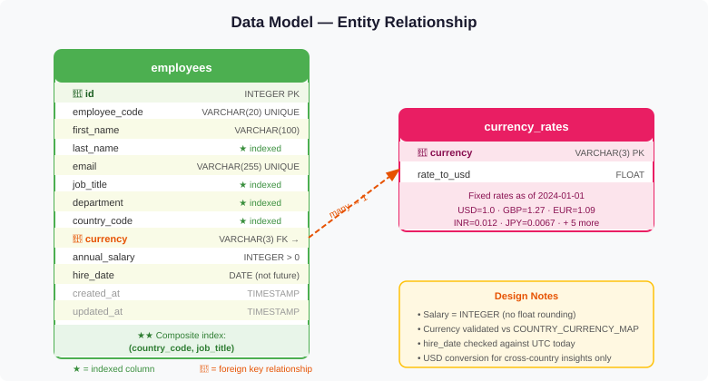
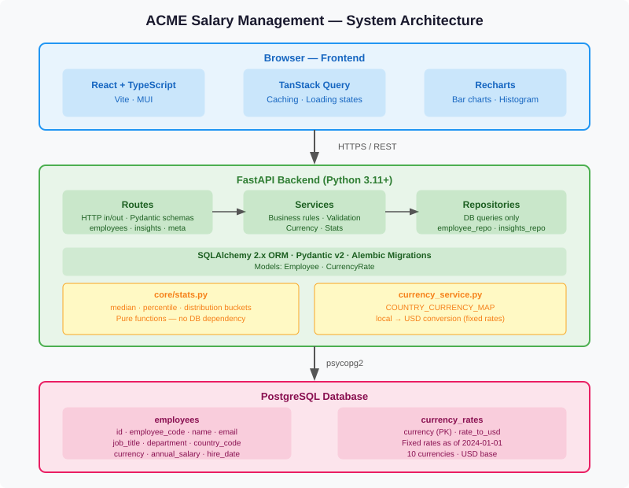

# ACME Salary Management

HR salary tool for ~10,000 employees (Incubyte take-home).

| Doc | Purpose |
|-----|---------|
| [docs/REQUIREMENTS.md](docs/REQUIREMENTS.md) | Scope and success criteria |
| [docs/ARTIFACTS.md](docs/ARTIFACTS.md) | Design decisions and AI usage log |
| [docs/IMPLEMENTATION_PLAN.md](docs/IMPLEMENTATION_PLAN.md) | Phases and stack |

All **`make`** targets are in the **root `Makefile`**. Run them from the repo root (`make help` lists everything).

## Live deployment

Production matches [docs/IMPLEMENTATION_PLAN.md](docs/IMPLEMENTATION_PLAN.md) §3a: **Railway** (API + Postgres) and **Vercel** (React UI). Pushes to the connected Git branch redeploy each service.

| | Link |
|---|------|
| **Deployed app (frontend)** | [https://test-task-incubyte.vercel.app/](https://test-task-incubyte.vercel.app/) |
| **Deployed API (backend apis)** | [https://testtask-incubyte-production.up.railway.app/docs](https://testtask-incubyte-production.up.railway.app/docs) |

| Layer | Platform | URL |
|-------|----------|-----|
| **Frontend (UI)** | [Vercel](https://vercel.com) | [test-task-incubyte.vercel.app](https://test-task-incubyte.vercel.app/) |
| **Backend (API)** | [Railway](https://railway.app) | [testtask-incubyte-production.up.railway.app](https://testtask-incubyte-production.up.railway.app) |
| **Database** | Railway Postgres | Private; API uses referenced `DATABASE_URL` |

| Endpoint | URL |
|----------|-----|
| Health | [GET /api/health](https://testtask-incubyte-production.up.railway.app/api/health) |
| OpenAPI / Swagger | [/docs](https://testtask-incubyte-production.up.railway.app/docs) |

**Vercel build env:** `VITE_API_URL=https://testtask-incubyte-production.up.railway.app` (no trailing slash; the app calls `/api/...`).

**Railway API env:** `DATABASE_URL` (reference Postgres), `CORS_ORIGINS` must include `https://test-task-incubyte.vercel.app` (and localhost origins if you still test locally).

On first deploy with an empty database, the API auto-seeds **10,000** employees (`AUTO_SEED_ON_STARTUP=true`). Migrations run on container start (`backend/scripts/railway-start.sh`).

## Architecture diagrams

**Data model**



**System architecture (local Docker and production)**



## Run with Docker (recommended)

Requires [Docker](https://docs.docker.com/get-docker/) and Compose.

```bash
cp .env.example .env
make up
```

| Service | URL |
|---------|-----|
| UI | http://localhost:5173 |
| API docs | http://127.0.0.1:8000/docs |

Stop: `Ctrl+C`, then `make down` (add `docker compose down -v` to reset DB).

If the UI shows missing `@mui/*` imports after pulling new frontend deps, recreate the frontend service (`docker compose up -d --build --force-recreate frontend`) or remove the `frontend_node_modules` volume once.

Compose variables live in **`.env`** (see `.env.example`).

## Host development (optional)

One-time setup:

```bash
cd backend && python3 -m venv .venv && .venv/bin/pip install -e ".[dev]"
cd ../frontend && npm install
cp frontend/.env.example frontend/.env   # VITE_API_URL
make env                                 # creates backend/.env
```

Postgres on `localhost:5432` (e.g. `make db-up`, wait until healthy), then:

```bash
make migrate
make run          # API :8000 — separate terminal: make ui for :5173
make seed         # optional if DB empty; API also auto-seeds on startup
make test
```

## Layout

```
Makefile             all make targets (repo root only)
docker-compose.yml   db + API + UI
backend/             FastAPI, Alembic, pytest
frontend/            React, Vite
docs/
```
